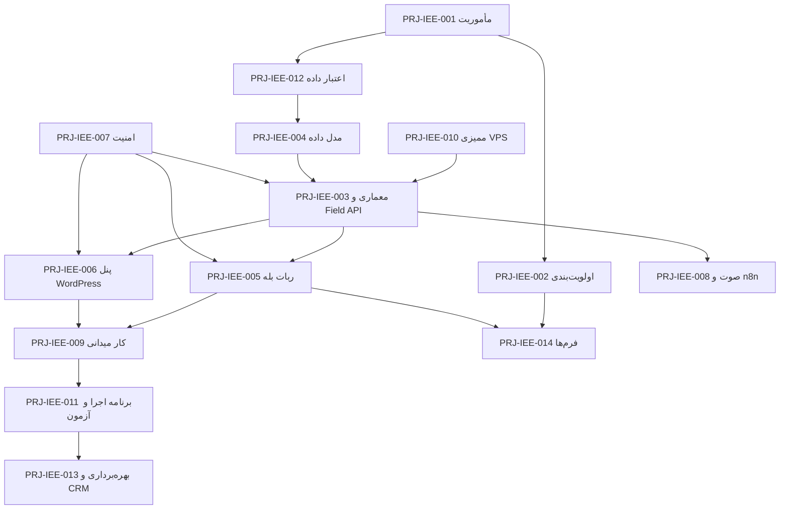

# PRJ-IEE-000 — نقشه پروژه IEE 1405 و راهنمای نودها

> [!abstract] هدف
> این نود، **نقطه ورود و نقشه مرجع** مجموعه نودهای پروژه «سامانه هوشمند مدیریت بازدیدها، شرکت‌ها و مذاکرات تجاری» ویژه بیست‌وششمین نمایشگاه بین‌المللی صنعت برق ایران (۱۶ تا ۱۹ آبان ۱۴۰۵) است: ترتیب مطالعه، وابستگی نودها، تصمیم‌های بنیادی مصوب و قواعد حاکم بر این پوشه را در یک جا ثبت می‌کند.

> [!warning] واقعیت زمانی — بازبینی تاریخ
> امروز **۱۴۰۵-۰۸-۱۰** است و نمایشگاه از **۱۶ آبان** آغاز می‌شود؛ یعنی تنها **۶ روز** فرصت اجرا باقی است. این محدودیت در [[PRJ-IEE-011 — برنامه اجرا، آزمون و آماده‌سازی پیش از نمایشگاه|PRJ-IEE-011]] به یک برنامه روزشمار (T-minus) با «تثبیت دامنه نسخه حداقلی» تبدیل شده است. هیچ‌کدام از الزامات مأموریت حذف نشده‌اند؛ فقط **ترتیب اجرا** بر اساس این واقعیت بازچینی شده است.

## فهرست

| # | بخش | # | بخش |
|---|---|---|---|
| ۱ | هدف (Why) | ۷ | قواعد حاکم بر پوشه |
| ۲ | وضعیت، دامنه و واقعیت زمانی | ۸ | اقدامات |
| ۳ | نقشه نودهای پروژه | ۹ | خروجی (Deliverable) |
| ۴ | ترتیب مطالعه و وابستگی‌ها | ۱۰ | ریسک‌ها |
| ۵ | تصمیم‌های بنیادی (D-1 تا D-9) | ۱۱ | ارجاعات |
| ۶ | وضعیت اجرایی نودها | ۱۲ | Changelog |

---

## ۱. هدف (Why)

این نود، **نقطه ورود و نقشه مرجع** مجموعه نودهای پروژه «سامانه هوشمند مدیریت بازدیدها، شرکت‌ها و مذاکرات تجاری» ویژه بیست‌وششمین نمایشگاه بین‌المللی صنعت برق ایران است. مأموریت این پروژه صرفاً جمع‌آوری اطلاعات در چهار روز نمایشگاه نیست؛ ساخت **پی‌بنای دائمی مدیریت ارتباط با شرکت‌ها، تأمین‌کنندگان، مشتریان، مذاکرات و فرصت‌های تجاری Xennic** است، به‌گونه‌ای که داده‌های جمع‌آوری‌شده مستقیماً در CRM، سامانه تأمین‌کنندگان و پلتفرم اصلی Xennic قابل استفاده مجدد باشند.

این نود:

- تنها مرجع «نقشه» این پوشه است؛ محتوای تخصصی هر موضوع در نود مستقل خودش نوشته می‌شود و در اینجا تکرار نمی‌شود (قاعده ۹ در [[META-CONV-001 — قواعد توسعه پروژه|META-CONV-001]]).
- تصمیم‌های بنیادی (بند ۵) را به‌صورت فشرده و قابل ارجاع ثبت می‌کند؛ هر نود اجرایی به شماره تصمیم ارجاع می‌دهد.
- ترتیب مطالعه و ترتیب اجرا را از هم تفکیک می‌کند (بند ۴).
- قواعد حاکم بر این پوشه را تعیین می‌کند (بند ۷)، از جمله ممنوعیت ثبت داده واقعی شرکت‌ها در این Vault.

**رابطه با نودهای دیگر**:

- [[META-INT-080 — معماری کلان سیستم‌عامل هوشمند سازمانی Xennic|META-INT-080]]: چارچوب حاکمیتی بالادستی؛ اصل «Single Source of Truth»، «API-first» و «Evidence-based AI» این پروژه از همان سند گرفته شده است.
- [[META-INT-150 — یکپارچه‌سازی معماری وب‌سایت و پلتفرم Xennic|META-INT-150]]: تصمیم معماری Modular Monolith و Schema-per-Domain که پایگاه‌داده این پروژه باید در همان قالب ساخته شود، نه به‌صورت یک دیتابیس مستقل نمایشگاهی.
- [[L2-OPS-002 — سامانه هوشمند تأمین و فروش تجهیزات برق|L2-OPS-002]]: نزدیک‌ترین سامانه موجود به موضوع این پروژه (تأمین‌کننده، کاتالوگ، CRM، ماتریس تأیید)؛ مدل موجودیت‌ها و اصول اعتبار داده از آن گرفته شده و در این پروژه تکرار نمی‌شود.
- [[META-INT-140 — نقشه مهاجرت زیرساخت اتوماسیون به سرور اختصاصی (VPS)|META-INT-140]]: تنها مرجع وضعیت واقعی VPS (مشخصات، SSH، Docker، پشته سرویس‌ها) که ممیزی این پروژه بر آن سوار می‌شود.

---

## ۲. وضعیت، دامنه و واقعیت زمانی

### ۲.۱. مشخصات رویداد

| مورد | مقدار | وضعیت اعتبار |
|---|---|---|
| نام رسمی | بیست‌وششمین نمایشگاه بین‌المللی صنعت برق ایران (و انرژی‌های تجدیدپذیر) | `reported` — منبع عمومی نمایشگاهی |
| تاریخ (شمسی) | ۱۶ تا ۱۹ آبان ۱۴۰۵ | `reported` |
| تاریخ (میلادی) | ۷ تا ۱۰ نوامبر ۲۰۲۶ | `reported` |
| محل | محل دائمی نمایشگاه‌های بین‌المللی تهران | `reported` |
| ساعت کار روزانه | ۰۹:۰۰ تا ۱۷:۰۰ | `reported` |
| تعداد مشارکت‌کننده | حدود ۴۶۰ مشارکت‌کننده (حدود ۴۰۰ مجموعه داخلی و ۶۰ شرکت خارجی یا نمایندگی) | `reported` — خبر عمومی ۱۴۰۵-۰۸-۰۹ |
| آخرین بازبینی این جدول | ۱۴۰۵-۰۸-۱۰ | `observed` |

> [!note] چرا ستون «وضعیت اعتبار» دارد؟
> طبق اصل تفکیک منشأ اطلاعات ([[PRJ-IEE-012 — اعتبار داده، منبع و شواهد|PRJ-IEE-012]])، حتی اطلاعات خودِ نمایشگاه هم بدون سطح اعتبار ثبت نمی‌شوند. اعداد رسمی نهایی (فهرست غرفه‌ها و راهنمای سالن‌ها) **باید** در روزهای نزدیک نمایشگاه از منبع رسمی برگزارکننده بازبینی و به `verified` ارتقا یابد؛ این یک اقدام باز در بند ۸ است.

### ۲.۲. دامنه

| در دامنه (In scope) | خارج از دامنه (Out of scope) |
|---|---|
| شناسایی و ثبت شرکت‌ها، غرفه‌ها، مدیران و کارشناسان | خرید یا تعهد تجاری در حین نمایشگاه |
| ثبت مذاکرات، یادداشت، صوت و عکس میدانی | پیش‌کالا/پیش‌فاکتور و فرایند فروش (دامنه `L2-OPS-002`) |
| اعتبارسنجی و اولویت‌بندی فرصت‌های همکاری | ارزیابی فنی رسمی تجهیزات یا صدور تأییدیه انطباق |
| ساخت پایگاه‌داده دائمی CRM-پایه و Field API | مهاجرت کامل CRM و بازنویسی `L2-OPS-002` |
| دو رابط کاربری: ربات بله و پنل WordPress | توسعه اپلیکیشن موبایل بومی |
| پردازش صوت، ذخیره فایل و اتوماسیون پس‌پردازش | تحلیل هوش مصنوعی به‌عنوان «حقیقت» (همیشه پیشنهاد است) |

### ۲.۳. واقعیت زمانی و محدودیت منابع

| مؤلفه | واقعیت امروز | اثر بر برنامه |
|---|---|---|
| زمان تا افتتاح | ۶ روز (۱۰ تا ۱۶ آبان) | نسخه حداقلی قابل‌اتکا بر «ربات بله + Field API + پایگاه‌داده» متمرکز می‌شود؛ پنل WordPress در نسخه خواندنی/ویرایش محدود |
| نیروی انسانی | تک‌بنیان‌گذار + دو گوشی در روز نمایشگاه | رابط‌ها باید در کمتر از ۳۰ ثانیه یک رکورد را ثبت کنند |
| زیرساخت | VPS فعال با Docker، بدون دامنه متصل و بدون TLS عمومی تأییدشده | **بزرگ‌ترین ریسک زمانی**؛ بند ۱۰ ردیف ۱ و نود [[PRJ-IEE-010 — ممیزی VPS و PostgreSQL|PRJ-IEE-010]] |
| پردازش صوت | سقف RAM سرور ۶ گیگابایت با سرویس‌های موجود | پردازش صوت به‌صورت صف و پس از نمایشگاه به‌طور پیش‌فرض |

---

## ۳. نقشه نودهای پروژه

| # | نود | موضوع | نقش در پروژه |
|---|---|---|---|
| ۱ | [[PRJ-IEE-001 — مأموریت، دامنه و اهداف نمایشگاه\|PRJ-IEE-001]] | مأموریت، اهداف، محدوده، معیار موفقیت | چرایی و چه‌چیزی |
| ۲ | [[PRJ-IEE-002 — اولویت‌بندی و ارزیابی شرکت‌ها\|PRJ-IEE-002]] | گروه‌های A/B/C، معیار امتیازدهی، دسته‌بندی محصول | هدف‌گذاری بازدید |
| ۳ | [[PRJ-IEE-003 — معماری سامانه و Field API\|PRJ-IEE-003]] | معماری کلان، اجزا، مرزها، پشته فناوری | چگونه ساخته می‌شود |
| ۴ | [[PRJ-IEE-004 — مدل داده و طرح پایگاه داده\|PRJ-IEE-004]] | موجودیت‌ها، Schemaها، فیلدهای اعتبار، مهاجرت | ساختار داده دائمی |
| ۵ | [[PRJ-IEE-005 — ربات بله (رابط عملیاتی)\|PRJ-IEE-005]] | فرمان‌ها، جریان گفت‌وگو، رسانه، آفلاین | رابط میدانی |
| ۶ | [[PRJ-IEE-006 — پنل WordPress روی هاست اشتراکی\|PRJ-IEE-006]] | پلاگین، احراز هویت، صفحات، خروجی Excel | رابط مدیریتی |
| ۷ | [[PRJ-IEE-007 — امنیت، هویت و Audit Log\|PRJ-IEE-007]] | احراز هویت، نقش‌ها، کنترل تعارض، ردگیری | مرز اعتماد |
| ۸ | [[PRJ-IEE-008 — صوت، فایل و اتوماسیون n8n\|PRJ-IEE-008]] | Whisper محلی، ذخیره فایل، Workflowها | پس‌پردازش |
| ۹ | [[PRJ-IEE-009 — روش کار میدانی، آفلاین و دو گوشی\|PRJ-IEE-009]] | سناریوی دو گوشی، آفلاین، همگام‌سازی | اجرای واقعی |
| ۱۰ | [[PRJ-IEE-010 — ممیزی VPS و PostgreSQL\|PRJ-IEE-010]] | ممیزی، پیش‌نیازها، DNS/TLS، تصمیم استقرار | پیش‌نیاز فنی |
| ۱۱ | [[PRJ-IEE-011 — برنامه اجرا، آزمون و آماده‌سازی پیش از نمایشگاه\|PRJ-IEE-011]] | روزشمار، دامنه نسخه حداقلی، آزمون پذیرش | زمان‌بندی |
| ۱۲ | [[PRJ-IEE-012 — اعتبار داده، منبع و شواهد\|PRJ-IEE-012]] | چهار سطح اعتبار، منبع، تاریخ بررسی، حکمیت AI | کیفیت داده |
| ۱۳ | [[PRJ-IEE-013 — بهره‌برداری، پشتیبان‌گیری و مسیر CRM\|PRJ-IEE-013]] | بهره‌برداری، پشتیبان، بازیابی، انتقال به CRM | پس از نمایشگاه |
| ۱۴ | [[PRJ-IEE-014 — فرم‌ها، قالب‌ها و چک‌لیست‌های میدانی\|PRJ-IEE-014]] | فرم سریع، چک‌لیست غرفه، قالب مذاکره | ابزار روز اجرا |

> [!important] قاعده جلوگیری از دوباره‌کاری
> پیش از افزودن هر نود جدید به این پوشه، ابتدا این جدول و سپس نودهای [[META-INT-080 — معماری کلان سیستم‌عامل هوشمند سازمانی Xennic|META-INT-080]]، [[L2-OPS-002 — سامانه هوشمند تأمین و فروش تجهیزات برق|L2-OPS-002]] بررسی می‌شود. هر نودی که موضوعش از قبل در جای دیگری مستند است، **Version Bump** می‌شود، نه تکرار.

---

## ۴. ترتیب مطالعه و وابستگی‌ها

### ۴.۱. ترتیب مطالعه برای اجرا

```text
PRJ-IEE-000 (همین نود)
   ├── 001 مأموریت و اهداف
   ├── 012 اعتبار داده و شواهد        ← پیش از طراحی مدل داده
   ├── 002 اولویت‌بندی شرکت‌ها        ← پیش از طراحی فرم‌ها
   ├── 010 ممیزی VPS                  ← پیش‌نیاز فنی
   ├── 003 معماری و Field API
   ├── 004 مدل داده
   ├── 007 امنیت و Audit
   ├── 005 ربات بله
   ├── 006 پنل WordPress
   ├── 008 صوت، فایل و n8n
   ├── 009 روش کار میدانی
   ├── 014 فرم‌ها و چک‌لیست‌ها
   ├── 011 برنامه اجرا و آزمون
   └── 013 بهره‌برداری و مسیر CRM
```

### ۴.۲. وابستگی فنی



---

## ۵. تصمیم‌های بنیادی (D-1 تا D-9)

این تصمیم‌ها در نودهای تفصیلی باز می‌شوند، اما مرجع شماره‌گذاری همین‌جاست.

| # | تصمیم | خلاصه | نود مرجع |
|---|---|---|---|
| D-1 | پایگاه‌داده دائمی، بدون دیتابیس موقت نمایشگاهی | داده‌های نمایشگاه در **همان نمونه PostgreSQL پلتفرم** و در Schemaهای دائمی (`crm`, `iee1405`) ساخته می‌شود؛ پس از نمایشگاه باقی می‌ماند | [[PRJ-IEE-004 — مدل داده و طرح پایگاه داده\|PRJ-IEE-004]] |
| D-2 | Field API تنها مسیر نوشتن و خواندن داده | ربات بله و WordPress هر دو فقط کلاینت Field API هستند؛ WordPress **هیچ اتصال مستقیمی** به PostgreSQL ندارد | [[PRJ-IEE-003 — معماری سامانه و Field API\|PRJ-IEE-003]] |
| D-3 | ربات بله به‌عنوان Gateway داخل سرویس Field API | منطق گفت‌وگو در همان سرویس پایتون پیاده می‌شود؛ n8n فقط برای کارهای غیرهمگام (صوت، گزارش، یادآوری) | [[PRJ-IEE-005 — ربات بله (رابط عملیاتی)\|PRJ-IEE-005]] |
| D-4 | آفلاین با «ضبط محلی + ورود دسته‌ای» | در نمایشگاه هیچ جریان وابسته به اینترنت پایدار طراحی نمی‌شود؛ PWA آفلاین به فاز بعد موکول می‌شود | [[PRJ-IEE-009 — روش کار میدانی، آفلاین و دو گوشی\|PRJ-IEE-009]] |
| D-5 | مدل شواهد در سطح «ادعا» و جدایی پیشنهادهای AI | هر مشخصه مهم یک رکورد ادعا با منبع، تاریخ و سطح اعتبار دارد؛ خروجی AI در جدول پیشنهاد نگهداری می‌شود، نه فیلد قطعی | [[PRJ-IEE-012 — اعتبار داده، منبع و شواهد\|PRJ-IEE-012]] |
| D-6 | کنترل تعارض با قفل خوش‌بینانه و کلید یکتای کلاینت | `version` + `If-Match` + `client_uuid` + `Idempotency-Key`؛ بازنویسی خاموش ممنوع | [[PRJ-IEE-007 — امنیت، هویت و Audit Log\|PRJ-IEE-007]] |
| D-7 | WordPress در فاز نمایشگاه = مشاهده + ویرایش محدود | نویسندگی کامل، مدیریت مخاطبان و گردش تأیید در نسخه پس از نمایشگاه | [[PRJ-IEE-006 — پنل WordPress روی هاست اشتراکی\|PRJ-IEE-006]] |
| D-8 | هیچ داده واقعی شرکت‌ها/PII در این Vault | Vault فقط سیاست و روش را ثبت می‌کند؛ داده در PostgreSQL روی VPS می‌ماند | [[PRJ-IEE-007 — امنیت، هویت و Audit Log\|PRJ-IEE-007]] |
| D-9 | دسترسی عمومی امن به Field API پیش‌نیاز مطلق است | یک نام میزبان با TLS معتبر روی VPS لازم است؛ بدون آن WordPress نمی‌تواند کار کند | [[PRJ-IEE-010 — ممیزی VPS و PostgreSQL\|PRJ-IEE-010]] |

> [!warning] تعارض ظاهری با [[META-INT-150 — یکپارچه‌سازی معماری وب‌سایت و پلتفرم Xennic|META-INT-150]]
> آن سند، CMS وب‌سایت را Payload دانسته و تصمیم معماری **وب‌سایت** را تعیین کرده است. این پروژه، WordPress را به‌عنوان **رابط مدیریتی داخلی روی هاست اشتراکی** به‌کار می‌گیرد، نه به‌عنوان CMS سایت عمومی؛ و چون WordPress به پایگاه‌داده دسترسی ندارد، اصل «یک منبع حقیقت» نقض نمی‌شود. مرز دقیق و دلیل انتخاب در [[PRJ-IEE-003 — معماری سامانه و Field API|PRJ-IEE-003]] بند ۴ آمده است.

---

## ۶. وضعیت اجرایی نودها

| نود | وضعیت سند | وضعیت پیاده‌سازی فنی |
|---|---|---|
| 000 تا 014 | `draft` | — (طراحی) |
| 003، 004، 007 | `draft` | نیازمند تأیید مالک پیش از کدنویسی |
| 010 | `draft` | ممیزی انجام‌نشده در این پروژه؛ شواهد قبلی از `META-INT-140` |

> [!note] وضعیت‌ها طبق قاعده ۱۱
> هیچ نودی مستقیماً `approved` نمی‌شود؛ مسیر `draft → review → approved → archived`. وضعیت «پیاده‌سازی فنی» عمداً جدا از وضعیت سند نگه داشته شده است تا سند تأییدشده با کد نوشته‌نشده اشتباه گرفته نشود.

---

## ۷. قواعد حاکم بر پوشه

| # | قاعده |
|---|---|
| ۱ | نام‌گذاری فایل‌ها: `<NODE-ID> — <عنوان فارسی>.md` با em-dash (U+2014) و فاصله دو طرف — قاعده ۱۶ |
| ۲ | frontmatter در خط اول، UTF-8 بدون BOM، `created` میلادی و تاریخ متن شمسی — قاعده ۴ و ۱۲ |
| ۳ | هر نود چهار بخش اجباری دارد: هدف، محتوا، ارجاعات، Changelog — قاعده ۴ |
| ۴ | هر نود دارای Callout چکیده، فهرست، خط جداکننده پیش از هر `##` و Changelog پررنگ است — قاعده ۱۷ |
| ۵ | هیچ داده واقعی شرکت، شخص، شماره تماس، قیمت یا عکس در این Vault ثبت نمی‌شود (D-8) |
| ۶ | مرجع کد منبع پروژه، **این Vault نیست**؛ کد در مخزن جداگانه نگهداری می‌شود (هم‌راستا با بند ۱۲ `META-INT-150`) |
| ۷ | هر تغییر معمارانه یا دامنه‌ای جدید، ابتدا در نود مربوطه با Version Bump ثبت و سپس کدنویسی می‌شود |
| ۸ | ارجاع به شرکتی مشخص فقط با شناسه داخلی (مثل `ORG-000123`) مجاز است، نه نام کامل؛ و حتی شناسه هم در این Vault لازم نیست |

> [!tip] وضعیت لایه و دامنه این پوشه
> این پروژه در پوشه `04_Projects/` با شناسه‌های `PRJ-IEE-NNN` ثبت شده است. چون [[META-CONV-001 — قواعد توسعه پروژه|META-CONV-001]] هنوز این لایه و این دامنه را در قاعده ۵ و ۶ تعریف نکرده، پیشنهاد رسمی افزودن آن در [[META-GOV-002 — پیشنهاد افزودن لایه Projects و دامنه IEE|META-GOV-002]] ثبت شده و تا تصویب مالک، وضعیت هر دو سند `draft` است.

---

## ۸. اقدامات

- [x] ایجاد ساختار پوشه `04_Projects/IEE_1405/` و نود نقشه
- [x] ثبت مشخصات رویداد با سطح اعتبار (بند ۲.۱)
- [x] ثبت تصمیم‌های بنیادی D-1 تا D-9 (بند ۵)
- [ ] تصویب [[META-GOV-002 — پیشنهاد افزودن لایه Projects و دامنه IEE|META-GOV-002]] توسط مالک و سپس Version Bump در `META-CONV-001`
- [ ] بازبینی اعداد رسمی مشارکت‌کنندگان و راهنمای سالن‌ها از منبع رسمی و ارتقای سطح اعتبار به `verified`
- [ ] تغییر وضعیت نودهای ۰۰۳، ۰۰۴، ۰۰۷ از `draft` به `review` پس از تأیید مالک
- [ ] افزودن بخش `04_Projects` به `README.md`، `Dashboard.md` و اسکریپت فهرست خودکار

---

## ۹. خروجی (Deliverable)

مجموعه‌ای از ۱۵ نود مستند که با هم، **نقشه کامل اجرای پروژه** را می‌سازند: از مأموریت و معیار ارزیابی شرکت‌ها تا معماری، مدل داده، دو رابط کاربری، امنیت، کار میدانی، برنامه شش‌روزه و مسیر بهره‌برداری دائمی. این مجموعه باید به‌تنهایی برای «شروع پیاده‌سازی توسط یک نشست توسعه جدید» کافی باشد.

---

## ۱۰. ریسک‌ها

| # | ریسک | اثر | راه‌حل |
|---|---|---|---|
| ۱ | نبود نام میزبان و TLS معتبر برای Field API تا پیش از نمایشگاه | WordPress کاملاً بی‌استفاده می‌شود؛ ربات هم بدون HTTPS عمومی باید Polling بزند | مسیر جایگزین: ربات با Polling کار می‌کند و پنل پس از نمایشگاه فعال می‌شود؛ اقدام فوری در [[PRJ-IEE-010 — ممیزی VPS و PostgreSQL\|PRJ-IEE-010]] |
| ۲ | کمبود زمان (۶ روز) و همزمانی با آماده‌سازی سفر | نسخه ناقص | تثبیت دامنه حداقلی در [[PRJ-IEE-011 — برنامه اجرا، آزمون و آماده‌سازی پیش از نمایشگاه\|PRJ-IEE-011]] |
| ۳ | ثبت اطلاعات نادرست یا بدون منبع در فشار میدانی | آلودگی پایگاه‌داده دائمی | مدل ادعا و جدایی سطح اعتبار (D-5) + بازبینی شبانه |
| ۴ | ازدحام و اینترنت ضعیف محل نمایشگاه | از دست رفتن یادداشت | D-4 و چک‌لیست آفلاین |
| ۵ | تعارض با تصمیم‌های معماری قبلی (Payload/WordPress) | بازکاری | مرزبندی صریح در بند ۵ و نود ۰۰۳ |

---

## ۱۱. ارجاعات

### ارجاعات داخلی

- [[META-CONV-001 — قواعد توسعه پروژه|META-CONV-001]]
- [[META-GOV-002 — پیشنهاد افزودن لایه Projects و دامنه IEE|META-GOV-002]]
- [[META-INT-080 — معماری کلان سیستم‌عامل هوشمند سازمانی Xennic|META-INT-080]]
- [[META-INT-090 — رجیستری Workflowهای n8n|META-INT-090]]
- [[META-INT-100 — مدیریت Secrets و Credentials|META-INT-100]]
- [[META-INT-110 — زیرساخت به‌صورت کد و بازیابی پس از خرابی|META-INT-110]]
- [[META-INT-120 — نظارت، هشدار و مدیریت خطا|META-INT-120]]
- [[META-INT-140 — نقشه مهاجرت زیرساخت اتوماسیون به سرور اختصاصی (VPS)|META-INT-140]]
- [[META-INT-150 — یکپارچه‌سازی معماری وب‌سایت و پلتفرم Xennic|META-INT-150]]
- [[L2-OPS-001 — عملیات روزانه|L2-OPS-001]]
- [[L2-OPS-002 — سامانه هوشمند تأمین و فروش تجهیزات برق|L2-OPS-002]]
- [[L2-TEC-002 — سامانه هوشمند مدیریت انرژی و توسعه پروژه‌های مهندسی|L2-TEC-002]]
- [[L2-SEC-001 — امنیت اطلاعات|L2-SEC-001]]
- [[L2-PLT-001 — Xennic v1|L2-PLT-001]]

### ارجاعات خارجی

- Bale Bot API (سازگار با Telegram Bot API): https://tapi.bale.ai
- PostgreSQL 16 Documentation: https://www.postgresql.org/docs/16/
- Caddy Web Server: https://caddyserver.com/docs/

---

## ۱۲. Changelog

- **v0.1.0 (۱۴۰۵-۰۸-۱۰):** ایجاد اولیه؛ ثبت نقشه ۱۵ نود پروژه IEE 1405، مشخصات رویداد با سطح اعتبار، تصمیم‌های بنیادی D-1 تا D-9، قواعد حاکم بر پوشه و ریسک‌های اصلی با توجه به واقعیت زمانی شش‌روزه تا افتتاح نمایشگاه.
