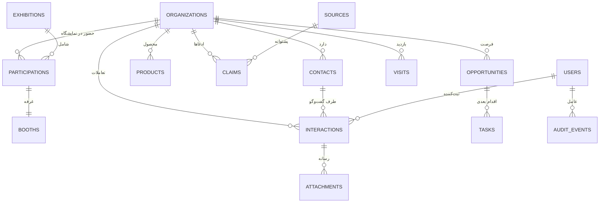

# PRJ-IEE-004 — مدل داده و طرح پایگاه داده

> [!abstract] هدف
> طراحی پایگاه‌داده **دائمی و توسعه‌پذیر** برای شرکت‌ها، مخاطبان، محصولات، تعاملات، ادعاها، فرصت‌ها، وظایف و شواهد نمایشگاه — به‌گونه‌ای که داده‌های چهار روز نمایشگاه، بدون بازنویسی، در CRM و سامانه تأمین‌کنندگان آینده Xennic قابل استفاده باشند.

## فهرست

| # | بخش | # | بخش |
|---|---|---|---|
| ۱ | هدف (Why) | ۷ | قواعد یکتایی، ایندکس و جست‌وجو |
| ۲ | اصول طراحی داده | ۸ | نسخه‌بندی، تاریخچه و حذف |
| ۳ | Schemaها و مرزهای دامنه | ۹ | مهاجرت و بذر داده مرجع |
| ۴ | موجودیت‌ها و رابطه‌ها | ۱۰ | حجم داده و کارایی |
| ۵ | تعریف جداول و فیلدها | ۱۱ | نماهای گزارش و خروجی |
| ۶ | مدل اعتبار داده (Claims) | ۱۲ | اقدامات و خروجی |
| | | ۱۳ | ریسک‌ها |
| | | ۱۴ | ارجاعات |
| | | ۱۵ | Changelog |

---

## ۱. هدف (Why)

داده‌ای که در نمایشگاه جمع می‌شود، **یک‌بار** جمع می‌شود و بعد از آن فقط می‌توان از آن استفاده کرد یا حسرت خورد. اگر مدل داده اشتباه باشد، نتیجه یکی از این دو است: یا داده‌ای ثبت می‌شود که بعداً قابل استفاده نیست (مثلاً نام شرکت در یک فیلد متنی آزاد)، یا برای اصلاح آن، هر رکورد باید دستی بازنویسی شود.

این نود سه هدف را دنبال می‌کند:

1. **دوام**: داده در همان نمونه PostgreSQL پلتفرم و در Schemaهای دائمی ساخته شود، نه در یک دیتابیس موقت نمایشگاهی (D-1).
2. **قابلیت استفاده مجدد**: موجودیت‌های عمومی (شرکت، مخاطب، محصول، تعامل) از ابتدا به‌گونه‌ای مدل شوند که نمایشگاه، فقط **یک بستر** روی آن‌ها باشد.
3. **صداقت داده**: وضعیت اعتبار هر ادعا، منبع و تاریخ آن در خودِ ساختار داده ذخیره شود، نه در متن یادداشت ([[PRJ-IEE-012 — اعتبار داده، منبع و شواهد|PRJ-IEE-012]]).

> [!important] رابطه نمایشگاه و CRM
> جدول‌های `crm.*` موجودیت‌های **دائمی** کسب‌وکار هستند؛ جدول‌های `iee1405.*` فقط **رخداد** نمایشگاه را ثبت می‌کنند (غرفه، بازدید، حضور). یعنی «شرکت الف در نمایشگاه ۱۴۰۵ غرفه ۳۸-۱۲ داشت» یک رکورد در `iee1405` است، نه یک شرکت دوم در `crm`.

---

## ۲. اصول طراحی داده

| # | اصل | پیاده‌سازی |
|---|---|---|
| ۱ | یک موجودیت، یک رکورد | شرکت حقوقی یکتا در `crm.organizations`؛ حضور در نمایشگاه در `iee1405.participations` |
| ۲ | جدایی واقعیت از ادعا | مقدار مشخصه در `crm.claims` با منبع و سطح اعتبار، نه ستون متنی روی شرکت |
| ۳ | تغییر ناپذیری تعاملات | `crm.interactions` فقط افزودنی؛ اصلاح = رکورد جدید از نوع `correction` |
| ۴ | کلید یکتای کلاینت | `client_uuid` در همه موجودیت‌های قابل ثبت آفلاین |
| ۵ | زمان دوگانه | `created_at`/`updated_at` سیستم (UTC) + `observed_at` زمان مشاهده واقعی |
| ۶ | حذف نرم | `deleted_at` + دلیل؛ حذف فیزیکی فقط برای داده آزمایشی با ثبت رویداد |
| ۷ | مقادیر مجاز بسته | `enums` در پایگاه‌داده، نه رشته آزاد در کد رابط |
| ۸ | نام‌گذاری یکسان | جدول جمع (جمع انگلیسی)، ستون `snake_case`، کلید خارجی `<entity>_id` |
| ۹ | هیچ داده شخصی در Git | داده در پایگاه‌داده؛ Vault فقط طرح (D-8) |
| ۱۰ | قابل مهاجرت | همه تغییرات با Alembic، بدون تغییر دستی روی سرور زنده |

---

## ۳. Schemaها و مرزهای دامنه

| Schema | وضعیت | محتوا | کاربر دیتابیس مجاز |
|---|---|---|---|
| `shared` | موجود/مصوب در `META-INT-150` | `customers` (هویت عمومی سایت) | `field_api` فقط خواندن |
| `crm` | **جدید (این پروژه)** | سازمان، مخاطب، محصول، ادعا، منبع، تعامل، فرصت، وظیفه، فایل، رویداد | `field_api` کامل |
| `iee1405` | **جدید (این پروژه)** | نمایشگاه، حضور، غرفه، بازدید، یادداشت میدانی | `field_api` کامل |
| `website` | موجود/آینده (`META-INT-150`) | محتوای سایت و لیدها | — |

> [!note] چرا `crm` و نه `iee1405` برای همه‌چیز؟
> اگر همه‌چیز داخل `iee1405` ساخته شود، پس از نمایشگاه باید یا نام Schema عوض شود یا داده به Schema جدید منتقل شود. با تفکیک فعلی، آیین نمایشگاه ۱۴۰۶ (و هر نمایشگاه دیگر) فقط چند ردیف به `iee1405.exhibitions` اضافه می‌کند — یا یک Schema جدید `iee1406` — بدون دست‌زدن به CRM.

### ۳.۱. رابطه با `shared.customers`

`shared.customers` (طبق `META-INT-150` بند ۴) هویت **کاربر عمومی آینده** (فروشگاه/پلتفرم) است؛ `crm.organizations` و `crm.contacts` هویت **طرف تجاری B2B** هستند. این دو ادغام نمی‌شوند:

- هیچ کلید خارجی از `crm.*` به `shared.customers` در فاز اول ساخته نمی‌شود.
- اگر در آینده لازم شد، یک جدول واسط `crm.customer_links` اضافه می‌شود — نه ادغام دو جدول.
- دلیل: سطح دسترسی، چرخه عمر و ماهیت حقوقی این دو متفاوت است (همان استدلال بند ۵ `META-INT-150`).

---

## ۴. موجودیت‌ها و رابطه‌ها



| گروه | موجودیت‌ها |
|---|---|
| دائمی کسب‌وکار (`crm`) | `organizations`, `contacts`, `products`, `product_categories`, `claims`, `sources`, `interactions`, `opportunities`, `tasks`, `attachments`, `users`, `audit_events`, `ai_suggestions` |
| نمایشگاهی (`iee1405`) | `exhibitions`, `participations`, `booths`, `visits`, `field_notes` |

---

## ۵. تعریف جداول و فیلدها

### ۵.۱. `crm.organizations` — شرکت/سازنده/تأمین‌کننده

| ستون | نوع | الزام | توضیح |
|---|---|---|---|
| `id` | `uuid` | PK | UUIDv7 |
| `client_uuid` | `uuid` | یکتا | تولید روی گوشی، مبنای جلوگیری از تکرار |
| `legal_name` | `text` | ✓ | نام حقوقی ثبت‌شده |
| `display_name` | `text` | | نام تجاری/برند |
| `legal_form` | `text` | | سهامی خاص، مسئولیت محدود، … |
| `country` | `char(2)` | | `IR` پیش‌فرض |
| `city` | `text` | | |
| `website` | `text` | | دامنه نرمال‌شده برای تشخیص تکرار |
| `phone_main` | `text` | | E.164 یا شماره داخلی |
| `email_main` | `text` | | |
| `org_type` | `org_type` | ✓ | `manufacturer`/`supplier`/`contractor`/`consultant`/`trader`/`software`/`other` |
| `initial_group` | `priority_group` | | گروه حوزه‌ای A/B/C (از نود ۰۰۲) |
| `effective_group` | `priority_group` | | گروه نتیجه ارزیابی |
| `score` | `numeric(5,2)` | | امتیاز ۰ تا ۱۰۰ |
| `score_breakdown` | `jsonb` | | پنج محور F/C/R/P/S |
| `override_reason` | `text` | | دلیل بازنویسی انسانی |
| `status` | `org_status` | ✓ | `active`/`watch`/`out`/`archived` |
| `version` | `integer` | ✓ | قفل خوش‌بینانه |
| `created_at`, `updated_at` | `timestamptz` | ✓ | |
| `created_by`, `updated_by` | `text` | ✓ | شناسه عامل |
| `deleted_at` | `timestamptz` | | حذف نرم |
| `notes_general` | `text` | | یادداشت آزاد (نه برای داده مهم) |

### ۵.۲. `crm.contacts` — مخاطب

| ستون | نوع | الزام | توضیح |
|---|---|---|---|
| `id`, `client_uuid` | `uuid` | ✓ | |
| `organization_id` | `uuid` | ✓ | FK |
| `full_name` | `text` | ✓ | |
| `role_title` | `text` | | سمت |
| `role_type` | `role_type` | | `manager`/`sales`/`technical`/`procurement`/`other` |
| `mobile`, `phone`, `email`, `messenger` | `text` | | `messenger` مثل شناسه بله |
| `preferred_channel` | `text` | | |
| `is_primary` | `boolean` | | مخاطب اصلی شرکت |
| `consent_note` | `text` | | توضیح اجازه تماس/استفاده از داده |
| `version`, `created_*`, `updated_*`, `deleted_at` | | ✓ | |

### ۵.۳. `crm.products` و `crm.product_categories`

| ستون | نوع | توضیح |
|---|---|---|
| `id`, `client_uuid` | `uuid` | |
| `organization_id` | `uuid` | سازنده/عرضه‌کننده |
| `category_code` | `text` | کلید به `product_categories.code` (مثل `CAP`, `TAB_MV`) |
| `name` | `text` | نام محصول/مدل |
| `model_code` | `text` | مدل یا Part Number |
| `key_specs` | `jsonb` | مشخصات کلیدی؛ هر مقدار مهم، ادعای متناظر در `claims` دارد |
| `standards` | `text[]` | استانداردهای اعلام‌شده |
| `availability` | `text` | ساخت داخل/واردات/نمایندگی |
| `version`, `created_*`, `updated_*` | | |

`product_categories` یک جدول مرجع کوچک با `code`, `title_fa`, `title_en`, `parent_code` است که از فهرست بند ۸ نود ۰۰۲ بذر می‌شود.

### ۵.۴. `crm.sources` — منبع

| ستون | نوع | توضیح |
|---|---|---|
| `id` | `uuid` | |
| `source_type` | `source_type` | `catalog`/`website`/`business_card`/`verbal`/`photo`/`audio`/`official_list`/`third_party` |
| `title` | `text` | عنوان/توضیح کوتاه |
| `uri` | `text` | لینک یا مسیر شاهد |
| `attachment_id` | `uuid` | اگر شاهد فایل است |
| `captured_by` | `text` | عامل ثبت |
| `captured_at` | `timestamptz` | زمان ثبت |
| `reliability` | `smallint` | ۱ تا ۵ (ارزیابی کیفیت منبع) |

### ۵.۵. `crm.claims` — ادعا (هسته صداقت داده)

| ستون | نوع | الزام | توضیح |
|---|---|---|---|
| `id`, `client_uuid` | `uuid` | ✓ | |
| `subject_type` | `text` | ✓ | `organization`/`contact`/`product` |
| `subject_id` | `uuid` | ✓ | |
| `attribute` | `text` | ✓ | مثل `capability.summary`, `capacity.monthly`, `has_agency` |
| `value_text` | `text` | | |
| `value_number` | `numeric` | | |
| `value_unit` | `text` | | |
| `value_json` | `jsonb` | | |
| `epistemic_status` | `epistemic_status` | ✓ | `verified`/`reported`/`inferred`/`observed` |
| `source_id` | `uuid` | شرطی | برای `verified` اجباری |
| `asserted_by` | `text` | | نام/سمت اعلام‌کننده |
| `observed_at` | `timestamptz` | ✓ | تاریخ مشاهده/اعلام |
| `reviewed_at` | `timestamptz` | | تاریخ آخرین بازبینی |
| `confidence` | `smallint` | | ۱ تا ۵، فقط برای `inferred` |
| `superseded_by` | `uuid` | | ادعای جایگزین (تاریخچه حفظ می‌شود) |
| `is_current` | `boolean` | ✓ | فقط یک ادعای جاری برای هر (موضوع، مشخصه) |

> [!important] محدودیت کلیدی
> ایندکس یکتای جزئی: `UNIQUE (subject_type, subject_id, attribute) WHERE is_current` — یعنی برای هر مشخصه، فقط **یک** ادعای جاری وجود دارد؛ ادعاهای قبلی با `superseded_by` و `is_current=false` باقی می‌مانند. این ساختار، «بازنویسی خاموش» را در سطح داده غیرممکن می‌کند.

### ۵.۶. `crm.interactions` — تعامل/مذاکره

| ستون | نوع | توضیح |
|---|---|---|
| `id`, `client_uuid` | `uuid` | |
| `organization_id` | `uuid` | |
| `contact_id` | `uuid` | اختیاری |
| `kind` | `interaction_kind` | `visit`/`meeting`/`call`/`demo`/`negotiation`/`correction` |
| `occurred_at` | `timestamptz` | زمان واقعی |
| `channel` | `text` | حضوری/بله/تلفن |
| `summary` | `text` | خلاصه یک‌خطی |
| `detail` | `text` | متن کامل (یا رونویسی) |
| `our_commitments` | `text` | تعهدات ما |
| `their_commitments` | `text` | تعهدات طرف مقابل |
| `sentiment` | `smallint` | ۰ تا ۵ (سرد تا گرم) |
| `next_action` | `text` | |
| `next_action_due` | `date` | |
| `recorded_by` | `text` | |
| `created_at` | `timestamptz` | |

### ۵.۷. `crm.opportunities` و `crm.tasks`

| جدول | ستون‌های کلیدی |
|---|---|
| `opportunities` | `id`, `organization_id`, `title`, `type` (`supply`/`project`/`agency`/`tech_partner`/`resale`/`out_of_scope`), `stage` (`idea`/`qualified`/`contacted`/`negotiating`/`won`/`lost`/`hold`), `value_estimate`, `currency`, `probability`, `owner`, `next_step`, `closed_at` |
| `tasks` | `id`, `organization_id`, `opportunity_id`, `title`, `due_date`, `priority`, `assignee`, `status` (`open`/`done`/`cancelled`), `completed_at`, `source_interaction_id` |

### ۵.۸. `iee1405` — جداول نمایشگاه

| جدول | ستون‌های کلیدی |
|---|---|
| `exhibitions` | `id`, `code` (`IEE1405`), `title`, `start_date`, `end_date`, `venue`, `city`, `official_source_id`, `verified_at` |
| `participations` | `id`, `organization_id`, `exhibition_id`, `hall`, `booth_number`, `participation_type` (`exhibitor`/`visitor`/`both`), `brands_shown` `text[]`, `confirmed` `boolean` |
| `booths` | `id`, `exhibition_id`, `hall`, `number`, `location_note` (نزدیک ورودی/سالن مجاور) — برای جست‌وجوی سریع مسیر |
| `visits` | `id`, `client_uuid`, `organization_id`, `exhibition_id`, `visited_at`, `by_user`, `duration_min`, `outcome` (`data_only`/`follow_up`/`meeting_set`/`not_relevant`), `visit_score` |
| `field_notes` | `id`, `client_uuid`, `organization_id`, `raw_text`, `transcript`, `language`, `device`, `sync_state` (`local_only`/`synced`), `captured_at`, `synced_at` |

### ۵.۹. `crm.attachments` و `crm.ai_suggestions`

| جدول | ستون‌های کلیدی |
|---|---|
| `attachments` | `id`, `kind` (`photo`/`audio`/`catalog`/`scan`), `sha256` (یکتا), `mime`, `size_bytes`, `storage_path`, `duration_sec`, `linked_entity`, `linked_id`, `uploaded_by`, `captured_at`, `privacy_flag` (مثلاً حذف GPS) |
| `ai_suggestions` | `id`, `target_entity`, `target_id`, `suggestion_type` (`extract`/`classify`/`summarize`/`match`/`score`), `payload` `jsonb`, `model`, `model_version`, `prompt_hash`, `status` (`proposed`/`accepted`/`rejected`), `reviewed_by`, `reviewed_at` |

> [!warning] هیچ ستون «نتیجه AI»
> `ai_suggestions` هیچ کلید خارجی معکوس به ستون‌های قطعی شرکت ندارد. پذیرش یک پیشنهاد، یک **ادعای جدید** با `epistemic_status=inferred` و منبع مشخص تولید می‌کند.

### ۵.۱۰. `crm.users` و `crm.audit_events`

| جدول | ستون‌های کلیدی |
|---|---|
| `users` | `id`, `username`, `display_name`, `role` (`owner`/`analyst`/`field_agent`/`viewer`/`service`), `bale_chat_id`, `is_active`, `last_seen_at` |
| `audit_events` | `id` (bigserial), `occurred_at`, `actor`, `action` (`create`/`update`/`delete`/`export`/`login`/`approve`), `entity`, `entity_id`, `before` `jsonb`, `after` `jsonb`, `diff` `jsonb`, `request_id`, `ip_hash` |

---

## ۶. مدل اعتبار داده (Claims)

### ۶.۱. چهار سطح اعتبار

| سطح | تعریف | شرط ثبت | نمونه |
|---|---|---|---|
| `verified` | تأییدشده با منبع معتبر و قابل ارجاع | `source_id` معتبر **الزامی** | گواهی نمایندگی اسکن‌شده |
| `reported` | اعلام‌شده توسط شرکت یا نماینده | نام اعلام‌کننده **الزامی** | «ظرفیت ماهانه ۵۰۰ عدد» از زبان کارشناس |
| `observed` | مشاهده مستقیم ثبت‌کننده | زمان و مکان **الزامی** | عکس تابلو موجود در غرفه |
| `inferred` | استنباط از شواهد | `confidence` و شرح استدلال **الزامی** | «احتمالاً نماینده انحصاری است» |

### ۶.۲. قواعد اعتبارسنجی در لایه دامنه

| قاعده | پیامد نقض |
|---|---|
| `verified` بدون `source_id` | `422 business_rule_violation` |
| `reported` بدون `asserted_by` | `422` |
| `inferred` بدون `confidence` | `422` |
| ادعای جدید برای مشخصه موجود | ادعای قبلی `is_current=false` و `superseded_by` تنظیم می‌شود (اتمیک) |
| سطح اعتبار پایین‌تر، ادعای بالاتر را جایگزین می‌کند | مجاز است، اما `audit_event` با هشدار `downgrade` ثبت می‌شود |

---

## ۷. قواعد یکتایی، ایندکس و جست‌وجو

| قاعده | تعریف |
|---|---|
| یکتایی کلاینت | `UNIQUE (client_uuid)` در `organizations`, `contacts`, `interactions`, `visits`, `field_notes` |
| یکتایی دامنه | `UNIQUE (lower(website)) WHERE website IS NOT NULL` روی `organizations` |
| یکتایی ادعای جاری | ایندکس جزئی بند ۵.۵ |
| یکتایی فایل | `UNIQUE (sha256)` روی `attachments` |
| تشخیص تکرار نام | ایندکس `pg_trgm` روی `legal_name` + `similarity()` با آستانه ۰.۷ |
| جست‌وجوی فارسی | `to_tsvector('simple', …)` روی نام/برند/محصول + `pg_trgm` برای تحمل غلط املایی |
| ایندکس‌های عملیاتی | `(organization_id, occurred_at DESC)` روی `interactions`؛ `(due_date) WHERE status='open'` روی `tasks`؛ `(exhibition_id, hall)` روی `participations` |

> [!tip] چرا `simple` و نه `persian`؟
> پیکربندی `persian` در نصب‌های پیش‌فرض PostgreSQL همیشه موجود نیست. `simple` + `pg_trgm` در عمل برای جست‌وجوی نام شرکت و محصول کافی است و وابستگی نصب را حذف می‌کند.

---

## ۸. نسخه‌بندی، تاریخچه و حذف

| موضوع | قاعده |
|---|---|
| قفل خوش‌بینانه | ستون `version` در همه جداول قابل ویرایش؛ افزایش اتمیک در همان `UPDATE … WHERE version = :expected` |
| تعارض | صفر ردیف تغییر‌یافته = `409`؛ سرور نسخه فعلی و تفاضل فیلدها را برمی‌گرداند |
| تاریخچه سطح رکورد | `audit_events` با `before`/`after`/`diff` |
| تاریخچه سطح ادعا | `claims` با `superseded_by` (تاریخچه بدون حذف) |
| تعاملات | فقط افزودنی؛ اصلاح با `kind='correction'` و ارجاع به تعامل اصل |
| حذف | `deleted_at` + `deleted_by` + دلیل؛ حذف فیزیکی ممنوع جز داده آزمایشی با ثبت رویداد |
| بازگردانی | `POST /admin/restore/{entity}/{id}` فقط با نقش `owner` |

---

## ۹. مهاجرت و بذر داده مرجع

| # | گام | ابزار |
|---|---|---|
| ۱ | ایجاد Schemaها و `CREATE EXTENSION pg_trgm, pgcrypto` | Alembic |
| ۲ | ایجاد Enums و جداول مرجع (`product_categories`, نقش‌ها) | Alembic + SQL |
| ۳ | جداول `crm` سپس `iee1405` | Alembic |
| ۴ | بذر `exhibitions` با `IEE1405` و تاریخ‌های `reported` | script |
| ۵ | بذر `product_categories` از فهرست بند ۸ نود ۰۰۲ | script |
| ۶ | بذر `users` (مالک + عوامل میدانی) | script |
| ۷ | آزمون مهاجرت روی پایگاه‌داده آزمایشی و سپس اجرا روی واقعی | CI + دستی |

```sql
-- نمونه DDL کوتاه‌شده (مرجع نهایی: فایل‌های Alembic در مخزن کد)
CREATE SCHEMA IF NOT EXISTS crm;
CREATE SCHEMA IF NOT EXISTS iee1405;
CREATE EXTENSION IF NOT EXISTS pg_trgm;
CREATE EXTENSION IF NOT EXISTS pgcrypto;

CREATE TYPE crm.epistemic_status AS ENUM ('verified','reported','inferred','observed');

CREATE TABLE crm.organizations (
  id             uuid PRIMARY KEY DEFAULT gen_random_uuid(),
  client_uuid    uuid NOT NULL UNIQUE,
  legal_name     text NOT NULL,
  display_name   text,
  website        text,
  org_type       text NOT NULL,
  initial_group  text,
  effective_group text,
  score          numeric(5,2),
  score_breakdown jsonb,
  status         text NOT NULL DEFAULT 'active',
  version        integer NOT NULL DEFAULT 1,
  created_at     timestamptz NOT NULL DEFAULT now(),
  updated_at     timestamptz NOT NULL DEFAULT now(),
  created_by     text NOT NULL,
  updated_by     text NOT NULL,
  deleted_at     timestamptz
);
CREATE UNIQUE INDEX organizations_website_uq
  ON crm.organizations (lower(website)) WHERE website IS NOT NULL;
```

> [!warning] ممنوعیت SQL دستی روی سرور
> هیچ تغییری با `psql` روی پایگاه‌داده واقعی اعمال نمی‌شود؛ همه تغییرات از Alembic و در مخزن کد است. استثنا: عملیات اضطراری با ثبت در `audit_events` و یادداشت در گزارش روز.

---

## ۱۰. حجم داده و کارایی

| موجودیت | برآورد ۴ روز | رشد سالانه | ملاحظه |
|---|---|---|---|
| `organizations` | ۴۰ تا ۸۰ | ۲۰۰ تا ۵۰۰ | کوچک |
| `contacts` | ۸۰ تا ۱۵۰ | ۵۰۰+ | کوچک |
| `interactions` | ۱۵۰ تا ۳۰۰ | ۳٬۰۰۰+ | ایندکس زمانی کافی است |
| `claims` | ۳۰۰ تا ۸۰۰ | ۱۰٬۰۰۰+ | مهم‌ترین جدول از نظر رشد |
| `attachments` | ۳۰۰ تا ۸۰۰ فایل (۱ تا ۲۰ مگابایت) | چند گیگابایت | به Storage، نه پایگاه‌داده |
| `audit_events` | ۱٬۰۰۰ تا ۳٬۰۰۰ | ۵۰٬۰۰۰+ | آرشیو سالانه |

> [!note] نتیجه ظرفیت
> حجم منطقی داده در حد چند ده مگابایت است؛ فشار اصلی روی **دیسک** (فایل‌ها) و **RAM** (سرویس‌ها) است، نه روی پایگاه‌داده. پایش دیسک VPS در [[PRJ-IEE-010 — ممیزی VPS و PostgreSQL|PRJ-IEE-010]] آمده است.

---

## ۱۱. نماهای گزارش و خروجی

| نما | کاربرد | مصرف‌کننده |
|---|---|---|
| `crm.v_company_overview` | یک ردیف به‌ازای شرکت با شمارش تعامل/محصول و آخرین وضعیت | پنل WordPress |
| `crm.v_open_followups` | وظایف باز با سررسید و شرکت | یادآوری روزانه n8n |
| `crm.v_priority_pipeline` | فرصت‌ها به تفکیک مرحله و گروه مؤثر | گزارش مدیریتی |
| `crm.v_data_quality` | درصد رکوردهای دارای منبع، بدون مخاطب، بدون گروه | بازبینی شبانه |
| `iee1405.v_visit_log` | فهرست بازدیدها با سالن/غرفه و نتیجه | گزارش روزانه نمایشگاه |
| `crm.v_export_companies` | ستون‌های استاندارد خروجی Excel | خروجی `GET /exports/export.xlsx` |

> [!tip] قاعده خروجی
> Excel فقط از نما تولید می‌شود و **مرجع نیست**. اگر کاربری فایل را ویرایش و بازگرداند، ورود آن از مسیر API و با کنترل تعارض انجام می‌شود، نه Import کور.

---

## ۱۲. اقدامات و خروجی

### ۱۲.۱. اقدامات

- [x] تعیین Schemaها، موجودیت‌ها و مدل ادعا
- [x] تعیین قواعد یکتایی، ایندکس و تعارض
- [ ] تأیید نهایی فهرست فیلدهای الزامی با مالک
- [ ] نوشتن مهاجرت‌های Alembic (۰.۱ تا ۰.۳)
- [ ] بذر داده مرجع و آزمون مهاجرت
- [ ] ساخت نماها و آزمون خروجی Excel با داده نمونه

### ۱۲.۲. خروجی (Deliverable)

مجموعه مهاجرت‌های نسخه‌دار + مستند Schema + نماهای گزارش، که روی نمونه PostgreSQL پلتفرم اجرا می‌شود و پس از نمایشگاه بدون تغییر ساختاری قابل استفاده است.

---

## ۱۳. ریسک‌ها

| # | ریسک | اثر | راه‌حل |
|---|---|---|---|
| ۱ | طراحی بیش‌ازحد پیچیده در ۶ روز | تأخیر | حداقل جداول لازم برای نسخه ۰.۱؛ افزودن ستون آسان‌تر از تغییر ساختار است |
| ۲ | مدل ادعا برای کاربر میدانی سنگین باشد | ثبت ناقص | رابط کاربر فقط «ادعای اصلی» را می‌پرسد؛ بقیه پیش‌فرض `reported` می‌گیرد |
| ۳ | تکرار رکورد شرکت | آلودگی داده | `client_uuid` + هشدار شباهت نام + بازبینی شبانه |
| ۴ | دسترسی ناخواسته به Schema `shared` | نقض مرز | کاربر دیتابیس `field_api` فقط `SELECT` روی `shared` |
| ۵ | حذف ناخواسته با `DELETE` مستقیم | از دست رفتن داده | ممنوعیت حذف فیزیکی + محدودیت مجوز + پشتیبان شبانه |

---

## ۱۴. ارجاعات

- [[PRJ-IEE-000 — نقشه پروژه و راهنمای نودها|PRJ-IEE-000]]
- [[PRJ-IEE-002 — اولویت‌بندی و ارزیابی شرکت‌ها|PRJ-IEE-002]]
- [[PRJ-IEE-003 — معماری سامانه و Field API|PRJ-IEE-003]]
- [[PRJ-IEE-007 — امنیت، هویت و Audit Log|PRJ-IEE-007]]
- [[PRJ-IEE-012 — اعتبار داده، منبع و شواهد|PRJ-IEE-012]]
- [[PRJ-IEE-013 — بهره‌برداری، پشتیبان‌گیری و مسیر CRM|PRJ-IEE-013]]
- [[META-INT-150 — یکپارچه‌سازی معماری وب‌سایت و پلتفرم Xennic|META-INT-150]]
- [[META-INT-110 — زیرساخت به‌صورت کد و بازیابی پس از خرابی|META-INT-110]]
- [[L2-OPS-002 — سامانه هوشمند تأمین و فروش تجهیزات برق|L2-OPS-002]]

### ارجاعات خارجی

- PostgreSQL 16 — Constraints & Partial Indexes: https://www.postgresql.org/docs/16/ddl-constraints.html
- pg_trgm: https://www.postgresql.org/docs/16/pgtrgm.html
- Alembic: https://alembic.sqlalchemy.org

---

## ۱۵. Changelog

- **v0.1.0 (۱۴۰۵-۰۸-۱۰):** ایجاد اولیه؛ تعریف Schemaهای `crm` و `iee1405`، جداول اصلی با فیلدها، مدل ادعا با ایندکس یکتای جزئی، قواعد یکتایی/ایندکس/تعارض، طرح مهاجرت، برآورد حجم و نماهای خروجی.
