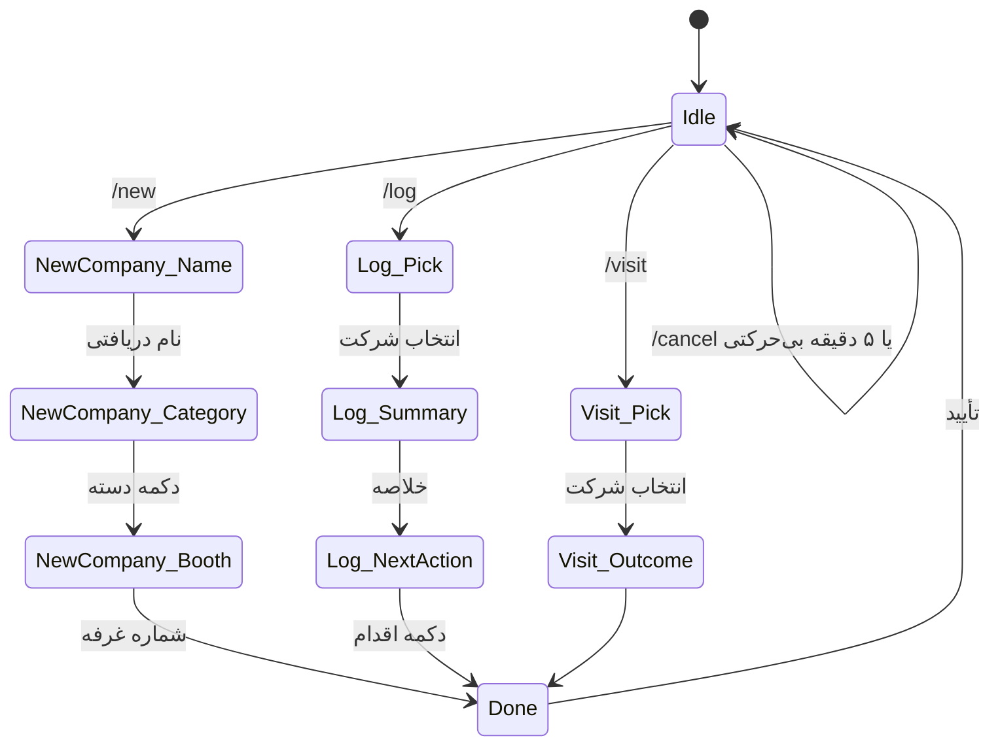

# PRJ-IEE-005 — ربات بله (رابط عملیاتی)

> [!abstract] هدف
> طراحی رابط عملیاتی میدانی روی پیام‌رسان بله: جست‌وجوی شرکت، ثبت سریع شرکت جدید، ثبت مذاکره و یادداشت، ثبت محصول، دریافت عکس و یادداشت صوتی، و ایجاد وظیفه پیگیری — با هدف **ثبت یک رکورد در کمتر از ۹۰ ثانیه با یک دست**.

## فهرست

| # | بخش | # | بخش |
|---|---|---|---|
| ۱ | هدف (Why) | ۷ | رسانه: عکس و صوت |
| ۲ | محدودیت‌های بستر بله | ۸ | ثبت آفلاین و همگام‌سازی |
| ۳ | معماری اتصال ربات | ۹ | ایمنی، دسترسی و خطا |
| ۴ | فهرست فرمان‌ها | ۱۰ | متن پیام‌های استاندارد |
| ۵ | جریان‌های اصلی (Step-by-step) | ۱۱ | آزمون و معیار پذیرش |
| ۶ | ماشین وضعیت گفت‌وگو | ۱۲ | اقدامات و خروجی |
| | | ۱۳ | ریسک‌ها |
| | | ۱۴ | ارجاعات |
| | | ۱۵ | Changelog |

---

## ۱. هدف (Why)

در نمایشگاه، کاربر با یک دست گوشی، کاتالوگ و کیف در دست دارد و طرف مقابل هم منتظر است. هر ثانیه اضافی در تایپ کردن، به کاهش کیفیت داده تبدیل می‌شود. بنابراین رابط میدانی باید سه ویژگی داشته باشد:

| ویژگی | معنی عملی |
|---|---|
| **سرعت** | حداکثر دو مرحله برای ثبت مهم‌ترین داده، بدون تایپ اجباری |
| **تحمل خطا** | پیام ناقص یا اشتباه، رکورد را خراب نمی‌کند؛ قابل ویرایش فوری است |
| **صداقت** | ربات هرگز داده را «قطعی» جا نمی‌زند؛ سطح اعتبار را می‌پرسد یا پیش‌فرض `reported` می‌گذارد |

ربات بله، **رابط اصلی** کار میدانی است؛ پنل WordPress برای مدیریت، گزارش و تکمیل تدریجی پرونده است. دلیل انتخاب بله: نصب‌شده روی هر دو گوشی، بدون نیاز به انتشار اپ، پشتیبانی فارسی و کارکرد در شبکه ایران.

---

## ۲. محدودیت‌های بستر بله

| # | واقعیت | پیامد طراحی |
|---|---|---|
| ۱ | Bot API بله با Telegram Bot API سازگار است (پایه: `https://tapi.bale.ai/bot<TOKEN>/`) | همان الگوهای شناخته‌شده پیام، Keyboard و فایل قابل استفاده است |
| ۲ | توکن از `@BotFather` داخل بله گرفته می‌شود | توکن فقط در `.env` سرور؛ هرگز در Vault یا چت |
| ۳ | دو حالت دریافت پیام: Long-Polling (`getUpdates`) یا Webhook با HTTPS عمومی | نسخه نمایشگاه: **Polling** (مستقل از دامنه و TLS عمومی) |
| ۴ | همه متدها و پارامترها دقیقاً مثل تلگرام نیستند | استفاده از حداقل مجموعه مستند: `sendMessage`, `sendPhoto`, `sendDocument`, `getFile`, `answerCallbackQuery` |
| ۵ | محدودیت نرخ ارسال | صف ارسال + فاصله حداقل ۵۰ میلی‌ثانیه + تلاش مجدد پرشی |
| ۶ | دانلود فایل از مسیر `file/bot<TOKEN>/…` | توکن در URL ظاهر می‌شود → ممنوعیت ثبت این URL در لاگ |
| ۷ | پیام‌های طولانی و Markdown مشکل‌زا | متن کوتاه، `parse_mode` ساده HTML و escape ورودی کاربر |
| ۸ | کاربر ممکن است چند پیام پشت‌سرهم بفرستد | پردازش ترتیبی به‌ازای هر `chat_id` (قفل سبک) |

> [!warning] قاعده «حداقل API»
> فقط از متدها و پارامترهایی استفاده می‌شود که در مستندات رسمی بله آمده یا در آزمون واقعی تأیید شده‌اند. اگر پارامتری خطای `400` داد، ارسال **بدون آن پارامتر** تکرار می‌شود (مثلاً `disable_web_page_preview`) — همان الگویی که در پیاده‌سازی‌های موجود دیده می‌شود.

---

## ۳. معماری اتصال ربات

```text
┌───────────┐  پیام/عکس/صوت  ┌────────────────┐  getUpdates  ┌──────────────────────┐
│  گوشی ۱   │ ─────────────▶ │ Bale Bot API   │ ◀─────────── │ bale_gateway         │
│  گوشی ۲   │ ◀───────────── │ tapi.bale.ai   │ ───────────▶ │ (داخل Field API)     │
└───────────┘  پاسخ        └────────────────┘  sendMessage └──────────┬───────────┘
                                                                       │
                                                     سرویس‌های دامنه ────┤
                                                                       ▼
                                                              PostgreSQL (crm/iee1405)
```

| جزء | مسئولیت |
|---|---|
| `bale_gateway.poller` | دریافت آپدیت با `getUpdates(offset, timeout=30)`، افزایش offset، ثبت خطا |
| `bale_gateway.router` | تشخیص Intent (فرمان یا متن آزاد)، انتخاب جریان |
| `bale_gateway.sessions` | وضعیت گفت‌وگوی هر کاربر در جدول `bale_sessions` (پایدار، نه در حافظه) |
| `bale_gateway.sender` | صف ارسال، تلاش مجدد، escape متن |
| `domains.*` | منطق کسب‌وکار (همان سرویس‌های مصرفی پنل) |

> [!note] چرا Polling؟
> Webhook به یک نام میزبان با TLS معتبر نیاز دارد که ممکن است تا روز نمایشگاه آماده نشود (D-9). Polling از سرور به بیرون درخواست می‌زند و مستقل از DNS/TLS ورودی کار می‌کند؛ پس ربات در هر شرایطی قابل بهره‌برداری است. مهاجرت به Webhook پس از تثبیت دامنه، بدون تغییر منطق انجام می‌شود.

---

## ۴. فهرست فرمان‌ها

| فرمان | کار | زمان هدف |
|---|---|---|
| `/start` | ثبت هویت کاربر و اتصال `chat_id` به کاربر سامانه | — |
| `/new` | ثبت شرکت جدید (جریان کوتاه) | ≤ ۹۰ ثانیه |
| `/find <کلیدواژه>` | جست‌وجوی شرکت/محصول/غرفه | ≤ ۵ ثانیه |
| `/org <ORG-ID>` | نمایش پرونده خلاصه شرکت | ≤ ۳ ثانیه |
| `/brief <ORG-ID>` | برگه پیش‌بازدید ([[PRJ-IEE-002 — اولویت‌بندی و ارزیابی شرکت‌ها\|PRJ-IEE-002]]) | ≤ ۳ ثانیه |
| `/log <ORG-ID>` | ثبت مذاکره/یادداشت برای شرکت | ≤ ۶۰ ثانیه |
| `/visit <ORG-ID>` | ثبت بازدید غرفه + نتیجه | ≤ ۳۰ ثانیه |
| `/product <ORG-ID>` | افزودن محصول/دسته | ≤ ۴۵ ثانیه |
| `/task <ORG-ID>` | ایجاد پیگیری با سررسید | ≤ ۳۰ ثانیه |
| `/note` | یادداشت آزاد (بدون شرکت) | ≤ ۲۰ ثانیه |
| `/voice` | راهنمای ثبت صوت | — |
| `/photo` | راهنمای ثبت عکس | — |
| `/today` | خلاصه ثبت‌های امروز من | ≤ ۳ ثانیه |
| `/open` | وظایف باز من | ≤ ۳ ثانیه |
| `/export` | ارسال فایل CSV خلاصه امروز | ≤ ۱۰ ثانیه |
| `/help` | راهنمای کوتاه | — |

> [!tip] قاعده دسترسی سریع
> هر فرمان با یک میان‌بر متنی هم کار می‌کند (`ن` برای جدید، `ج` برای جست‌وجو) تا در شلوغی، تایپ `/` لازم نباشد. فهرست کامل در [[PRJ-IEE-014 — فرم‌ها، قالب‌ها و چک‌لیست‌های میدانی|PRJ-IEE-014]].

---

## ۵. جریان‌های اصلی (Step-by-step)

### ۵.۱. ثبت شرکت جدید — `/new`

```text
ربات: نام شرکت را بنویسید یا عکس کارت ویزیت/غرفه را بفرستید.
کاربر: «آریا تابلو»
ربات: [دکمه‌های دسته] تابلو MV | تابلو LV | خازن/کیفیت توان | خورشیدی | ترانس | اتوماسیون | سایر
کاربر: (دکمه) تابلو MV
ربات: سالن و شماره غرفه؟ (مثال: ۳۸-۱۲)
کاربر: ۳۸-۱۲
ربات: ✅ ثبت شد — ORG-000123
      دسته: تابلو MV · غرفه: ۳۸-۱۲ · گروه اولیه: A
      [افزودن مخاطب] [ثبت مذاکره] [افزودن عکس]
```

| قاعده | جزئیات |
|---|---|
| تعداد پرسش | حداکثر ۳ پرسش؛ بقیه پیش‌فرض |
| عکس کارت ویزیت | پذیرفته می‌شود و به‌عنوان شاهد به شرکت متصل می‌شود (استخراج خودکار در فاز بعد) |
| تشخیص تکرار | اگر نام مشابه موجود باشد، هشدار با دکمه «همان شرکت است» / «شرکت جدید» |
| `client_uuid` | روی سرور تولید می‌شود؛ در حالت آفلاین روی گوشی (نود ۰۰۹) |
| سطح اعتبار | اطلاعات این جریان `reported` است، مگر کاربر دکمه «مشاهده کردم» را بزند → `observed` |

### ۵.۲. ثبت مذاکره — `/log`

```text
ربات: درباره کدام شرکت؟ (جست‌وجو یا ORG-ID)
کاربر: آریا
ربات: ۱) آریا تابلو — ORG-000123 (غرفه ۳۸-۱۲)   ۲) آریا صنعت — ORG-000201
کاربر: ۱
ربات: خلاصه گفت‌وگو در یک جمله؟
کاربر: تولید تابلو MV، نمایندگی ندارند، آماده همکاری فنی
ربات: اقدام بعدی؟ [ارسال کاتالوگ] [تماس هفته بعد] [بازدید کارخانه] [بدون اقدام]
کاربر: (دکمه) تماس هفته بعد
ربات: ✅ مذاکره ثبت شد (INT-…) — وظیفه: تماس ۲۴ آبان
```

### ۵.۳. بازدید غرفه — `/visit`

| گام | پرسش | مقادیر |
|---|---|---|
| ۱ | کدام شرکت؟ | جست‌وجو |
| ۲ | نتیجه بازدید | `data_only` / `follow_up` / `meeting_set` / `not_relevant` |
| ۳ | (اختیاری) عکس غرفه | آپلود یا رد |

### ۵.۴. برگه پیش‌بازدید — `/brief`

پاسخ ربات، حداکثر ۱۲ خط:

```text
🏢 ORG-000123 — آریا تابلو   (گروه A · امتیاز ۸۳)
📍 سالن ۳۸ · غرفه ۳۸-۱۲
🎯 چرا هدف است: تولیدکننده تابلو MV با نمایندگی رسمی
❓ دو سؤال کلیدی: ۱) ظرفیت ماهانه؟ ۲) امکان همکاری فنی؟
💬 پیام ما: Xennic — طراحی، تأمین و اجرای پروژه‌های توزیع و کیفیت توان
📄 وضعیت پرونده: ناقص (بدون مخاطب)   [ثبت مذاکره] [افزودن مخاطب]
```

### ۵.۵. وظیفه و پیگیری — `/task`

| گام | پرسش | پیش‌فرض |
|---|---|---|
| ۱ | شرکت مرتبط | — |
| ۲ | عنوان اقدام | — |
| ۳ | سررسید | «فردا» / «۳ روز» / «هفته بعد» / تاریخ |

---

## ۶. ماشین وضعیت گفت‌وگو



| قاعده | جزئیات |
|---|---|
| انقضای جلسه | ۵ دقیقه بی‌حرکتی → بازگشت به `Idle` با پیام «جلسه لغو شد» |
| ذخیره وضعیت | در جدول `bale_sessions(chat_id, state, payload jsonb, updated_at)` — بازگشت پس از ری‌استارت سرویس |
| لغو | `/cancel` در هر مرحله |
| پردازش هم‌زمان | قفل به‌ازای `chat_id`؛ پیام دوم در صف می‌ماند |
| پیام غیرمنتظره | پیام راهنما + دکمه‌های اصلی، بدون از دست دادن وضعیت |

---

## ۷. رسانه: عکس و صوت

### ۷.۱. عکس

| موضوع | قاعده |
|---|---|
| منابع عکس | غرفه، محصول، پلاک مشخصات، کاتالوگ، کارت ویزیت |
| حداکثر اندازه | ۸ مگابایت (بیشتر: پیام راهنما برای ارسال به‌عنوان فایل) |
| پردازش | دانلود → بررسی نوع واقعی → هش + ذخیره → اتصال به شرکت/تعامل |
| متادیتا | نگهداری GPS به‌صورت پیش‌فرض **حذف** می‌شود؛ در صورت نیاز، پرچم `keep_location` |
| توضیح | پس از هر عکس، ربات یک پرسش کوتاه می‌پرسد: «این عکس چه چیزی را نشان می‌دهد؟» (اختیاری، قابل رد) |

### ۷.۲. یادداشت صوتی

```text
ربات: یادداشت صوتی بفرستید. ابتدا شماره غرفه و نام شرکت را بگویید،
      سپس محصول، طرف گفت‌وگو و اقدام بعدی.
کاربر: (ویس ۴۵ ثانیه‌ای)
ربات: ✅ صوت ذخیره شد و در صف رونویسی قرار گرفت.
      تا آماده‌شدن متن، خلاصه خودتان را یک‌خطی بنویسید؟ [بله] [بعداً]
```

| موضوع | قاعده |
|---|---|
| طول مجاز | تا ۵ دقیقه؛ بیشتر از آن، پیام «لطفاً تکه‌تکه بفرستید» |
| رونویسی | پس از نمایشگاه به‌طور پیش‌فرض؛ در حین نمایشگاه فقط برای یادداشت‌های حساس (نود ۰۰۸) |
| ذخیره | فایل صوتی + متن رونویسی + خلاصه انسانی، سه موجودیت جدا با اتصال |
| سطح اعتبار | متن رونویسی `reported` است؛ تأیید انسانی آن را به `observed`/`verified` ارتقا می‌دهد |

> [!warning] قاعده صوتی طلایی
> در یادداشت صوتی، **همیشه اول شماره غرفه و نام شرکت** گفته می‌شود. اگر صوت بدون این دو ثبت شود و در پایان روز ده‌ها صوت جمع شده باشد، تطبیق آن‌ها با شرکت‌ها زمان‌بر و خطاپذیر می‌شود.

---

## ۸. ثبت آفلاین و همگام‌سازی

| سناریو | رفتار طراحی‌شده |
|---|---|
| اینترنت قطع است و ربات پاسخ نمی‌دهد | کاربر صوت/عکس را در گالری و ضبط‌کننده محلی ذخیره می‌کند + شماره غرفه را در یادداشت گوشی می‌نویسد |
| اینترنت برمی‌گردد | ارسال دسته‌ای به ربات با الگوی `IEE` + شماره غرفه یا `ORG-ID` |
| ارسال تکراری (کاربر دو بار می‌فرستد) | `client_uuid` یا `Idempotency-Key` مانع رکورد دوم می‌شود |
| پیام در میانه جریان گم می‌شود | جلسه با انقضا بسته می‌شود؛ ربات با «ادامه ثبت قبلی؟» بازیابی می‌کند |

> [!note] تصمیم D-4
> نسخه آفلاین کامل (PWA با IndexedDB) در این فاز ساخته نمی‌شود؛ روش «ضبط محلی + ورود دسته‌ای» در [[PRJ-IEE-009 — روش کار میدانی، آفلاین و دو گوشی|PRJ-IEE-009]] با جزئیات اجرایی آمده است.

---

## ۹. ایمنی، دسترسی و خطا

| # | قاعده |
|---|---|
| ۱ | فقط `chat_id` های ثبت‌شده در `crm.users` پذیرفته می‌شوند؛ بقیه پیام «دسترسی ندارید» می‌گیرند و رویداد ثبت می‌شود |
| ۲ | نقش `field_agent` اجازه حذف ندارد؛ حذف فقط با نقش `owner` و از پنل |
| ۳ | توکن ربات فقط در `.env` سرور؛ در لاگ ماسک می‌شود (`bot***:…`) |
| ۴ | هر ثبت، رویداد `audit_event` با `actor` و `request_id` دارد |
| ۵ | خطای داخلی به کاربر با پیام کوتاه و کد پیگیری نمایش داده می‌شود، نه stack trace |
| ۶ | پیام کاربر قبل از نمایش در گزارش، escape می‌شود (جلوگیری از تزریق HTML) |
| ۷ | محدودیت نرخ: حداکثر ۲۰ پیام در دقیقه به‌ازای `chat_id` |

---

## ۱۰. متن پیام‌های استاندارد

| موقعیت | متن |
|---|---|
| خوش‌آمد | «سلام 👋 به ربات میدانی Xennic خوش آمدید. برای ثبت شرکت جدید: /new — برای جست‌وجو: /find نام — راهنما: /help» |
| تأیید ثبت | «✅ ثبت شد — <شناسه>\n<خلاصه یک‌خطی>\n[ادامه] [افزودن عکس] [پایان]» |
| هشدار تکرار | «⚠️ شرکت مشابه پیدا شد: <نام> (<شناسه>). همان است یا شرکت جدید؟ [همان] [جدید]» |
| نبود نتیجه | «چیزی پیدا نشد. با نام کوتاه‌تر یا بخشی از برند جست‌وجو کنید، یا /new برای ثبت جدید.» |
| خطای موقت | «الان نشد (کد <request_id>). یک بار دیگر امتحان کنید؛ داده شما ذخیره نشده است.» |
| پایان روز | «📊 امروز: ۱۲ شرکت، ۹ مذاکره، ۳ عکس. /open برای وظایف باز.» |
| نبود دسترسی | «این حساب مجاز نیست. برای دسترسی با مدیر سامانه تماس بگیرید.» |

---

## ۱۱. آزمون و معیار پذیرش

| # | آزمون | معیار قبولی |
|---|---|---|
| ۱ | ثبت شرکت جدید روی هر دو گوشی | ≤ ۹۰ ثانیه، بدون خطا |
| ۲ | ثبت مذاکره با وظیفه | ≤ ۶۰ ثانیه، وظیفه در `/open` دیده شود |
| ۳ | جست‌وجوی فارسی با غلط املایی | نتیجه درست در سه نتیجه اول |
| ۴ | ارسال عکس ۵ مگابایتی | ذخیره و اتصال در ≤ ۱۵ ثانیه |
| ۵ | ارسال صوت ۶۰ ثانیه‌ای | ذخیره و ثبت در صف رونویسی |
| ۶ | ارسال تکراری همان پیام | فقط یک رکورد |
| ۷ | ری‌استارت سرویس در میانه گفت‌وگو | جلسه بازیابی و ادامه ممکن |
| ۸ | کاربر غیرمجاز | رد با پیام و رویداد ثبت‌شده |
| ۹ | ارسال ۲۰ پیام پشت‌سرهم | بدون گم‌شدن پیام، به‌ترتیب |
| ۱۰ | قطع و وصل اینترنت در میانه | هیچ داده‌ای نیمه‌کاره ثبت نشود |

---

## ۱۲. اقدامات و خروجی

### ۱۲.۱. اقدامات

- [x] تعیین فرمان‌ها، جریان‌ها و ماشین وضعیت
- [x] تعیین قواعد رسانه، خطا و دسترسی
- [ ] ایجاد ربات در `@BotFather` داخل بله و ثبت توکن در `.env` سرور (نه در Vault)
- [ ] ثبت `chat_id` دو گوشی در `crm.users`
- [ ] پیاده‌سازی `poller` + `router` + `sender`
- [ ] پیاده‌سازی جریان‌های `/new`, `/log`, `/visit`, `/find`, `/brief`, `/task`
- [ ] آزمون روی هر دو گوشی و رفع اختلاف رفتار API

### ۱۲.۲. خروجی (Deliverable)

ربات عملیاتی با حداقل هفت جریان، آزمون‌شده روی دو گوشی واقعی، با ثبت `audit_event` و پشتیبانی از بازیابی جلسه.

---

## ۱۳. ریسک‌ها

| # | ریسک | اثر | راه‌حل |
|---|---|---|---|
| ۱ | ناسازگاری رفتار API بله با تلگرام | خطای ارسال | حداقل پارامتر، آزمون زودهنگام، تلاش مجدد بدون پارامتر مشکل‌دار |
| ۲ | کندی شبکه محل نمایشگاه | تأخیر در ثبت | پاسخ کوتاه، صف ارسال، روش آفلاین |
| ۳ | تایپ فارسی دشوار روی گوشی کوچک | خطای ورودی | دکمه‌ها به‌جای تایپ؛ ورودی کوتاه |
| ۴ | فراموشی شماره غرفه در صوت | عدم تطبیق | قاعده صوتی طلایی (بند ۷.۲) |
| ۵ | از دست رفتن توکن | توقف ربات | توکن در Password Manager مالک؛ رویه چرخش در `META-INT-100` |

---

## ۱۴. ارجاعات

- [[PRJ-IEE-000 — نقشه پروژه و راهنمای نودها|PRJ-IEE-000]]
- [[PRJ-IEE-002 — اولویت‌بندی و ارزیابی شرکت‌ها|PRJ-IEE-002]]
- [[PRJ-IEE-003 — معماری سامانه و Field API|PRJ-IEE-003]]
- [[PRJ-IEE-004 — مدل داده و طرح پایگاه داده|PRJ-IEE-004]]
- [[PRJ-IEE-007 — امنیت، هویت و Audit Log|PRJ-IEE-007]]
- [[PRJ-IEE-008 — صوت، فایل و اتوماسیون n8n|PRJ-IEE-008]]
- [[PRJ-IEE-009 — روش کار میدانی، آفلاین و دو گوشی|PRJ-IEE-009]]
- [[PRJ-IEE-014 — فرم‌ها، قالب‌ها و چک‌لیست‌های میدانی|PRJ-IEE-014]]
- [[META-INT-090 — رجیستری Workflowهای n8n|META-INT-090]]
- [[META-INT-100 — مدیریت Secrets و Credentials|META-INT-100]]

### ارجاعات خارجی

- Bale Bot API (سازگار با Telegram Bot API): https://tapi.bale.ai
- Telegram Bot API Reference (مرجع رفتاری مشترک): https://core.telegram.org/bots/api

---

## ۱۵. Changelog

- **v0.1.0 (۱۴۰۵-۰۸-۱۰):** ایجاد اولیه؛ تعریف معماری اتصال (Polling)، ۱۶ فرمان، پنج جریان اصلی، ماشین وضعیت پایدار، قواعد رسانه و آفلاین، مدل دسترسی و خطا، متن پیام‌های استاندارد و آزمون پذیرش روی دو گوشی.
